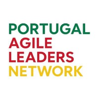

# 3.º Evento — 16 de Outubro de 2026

## Local

**Hiscox Portugal**
Atriaum Saldanha
Praça Duque de Saldanha, 1
Piso 5

## Programa

| Hora  | Sessão | Facilitadores |
| ----- | ------ | ------------- |
| 9:30  | Chegada | Miguel Duarte |
| 9:45  | Networking Icebreaker | Priscila Guimarães e Mariana Luciano |
| 10:00 | 2035 Rehearsing Our AI Future | Nuno Silva Pereira e Ricardo Caldas |
| 12:15 | Almoço — Italy Caffe, Rua Duque de Ávila | |
| 13:30 | Energizer | Priscila Guimarães e Mariana Luciano |
| 14:30 | (Mini) Open Space Technology Sessions | Miguel Duarte |
| 16:30 | Despedidas e marcar próximo evento | Miguel Duarte |
| 17:00 | Fim | |

## Sugestão de estacionamento

Telpark, Arco do Cego — dia inteiro fica nos 11 euros se reservar antes pela app.

---
*© Portugal Agile Leaders Network — licenciado sob [CC BY 4.0](https://creativecommons.org/licenses/by/4.0/deed.pt).*
